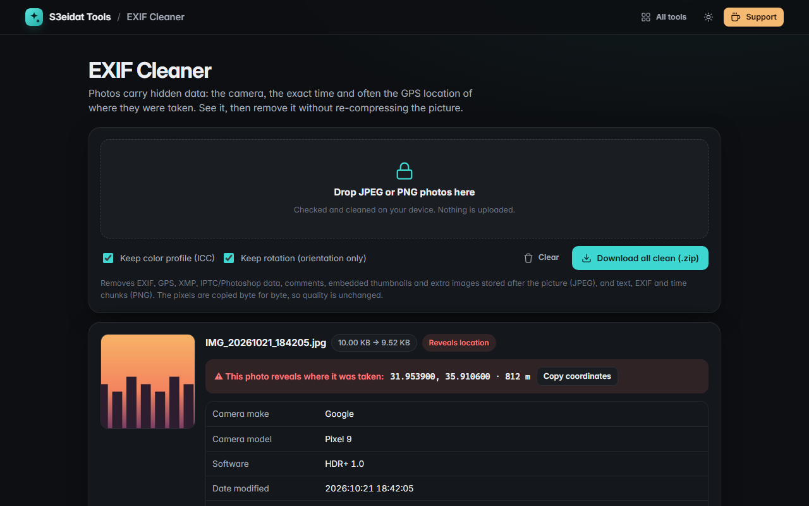

# EXIF Cleaner

> See and remove the hidden metadata in your photos, including GPS location. Free, private, and it runs entirely in your browser.

### ▶ [Open EXIF Cleaner](https://s3eidat.github.io/exif-cleaner/)



## Features

- **See what a photo reveals**: camera make and model, lens, settings, date taken, software, serial number,
  owner/artist, comments, and **GPS coordinates** with a clear warning
- **Remove it without re-compressing**: JPEG segments are rewritten and the image data is copied byte for byte,
  so quality and file structure stay intact
- Removes EXIF, GPS, XMP, IPTC/Photoshop blocks, comments, embedded thumbnails and extra images stored
  after the picture (JPEG); text, EXIF and time chunks (PNG)
- Optionally **keeps the color profile** (ICC) and the **rotation** (a tiny EXIF block with only the
  orientation, so portrait photos don't turn sideways)
- **Batch**: drop many photos, download each clean copy or **all as a .zip**
- Own minimal parsers with bounds checks on every read; damaged files are reported, not trusted

JPEG and PNG are supported. HEIC, WebP and RAW files are not.

## Privacy


Your photos never leave your device. There is no server, no account, no analytics.
The page ships with a strict Content-Security-Policy (`connect-src 'self'`), so the browser
itself blocks any attempt to send data anywhere.

## Run it yourself

It's plain HTML, CSS and JavaScript with no build step:

```bash
git clone https://github.com/s3eidat/exif-cleaner
cd exif-cleaner
python -m http.server 8000
```

Then open http://localhost:8000.

## Support

If this saved you time, **[buy me a coffee ☕](https://s3eidat.github.io/coffee/)**. It keeps every tool free.

---

Part of **[S3eidat Tools](https://s3eidat.github.io/)**: 100+ free, private tools that run in your browser. MIT licensed.
